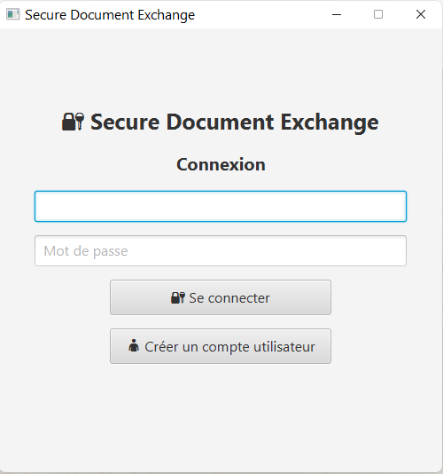
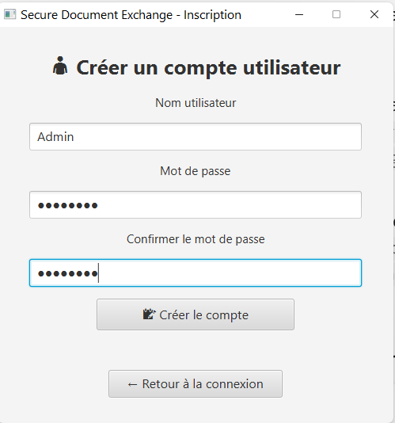
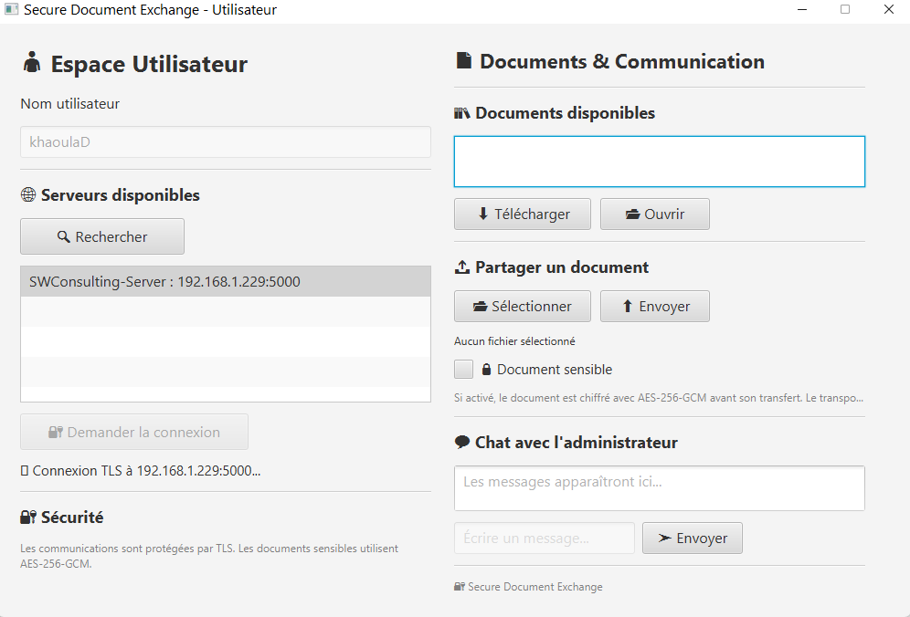
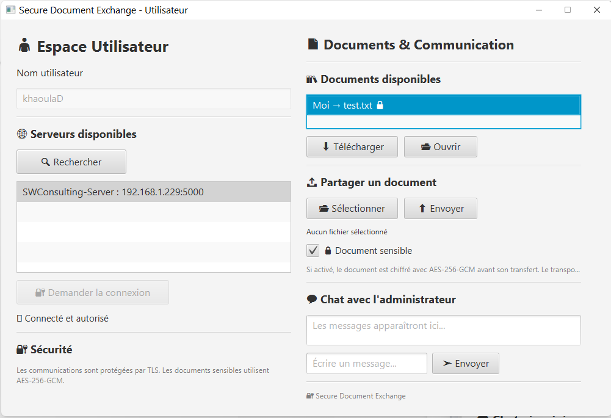
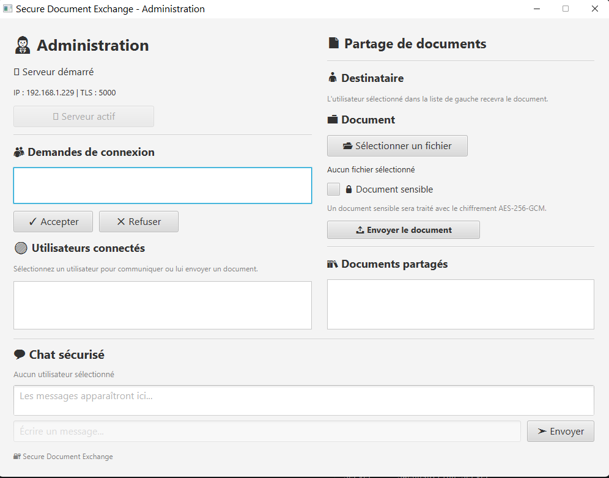
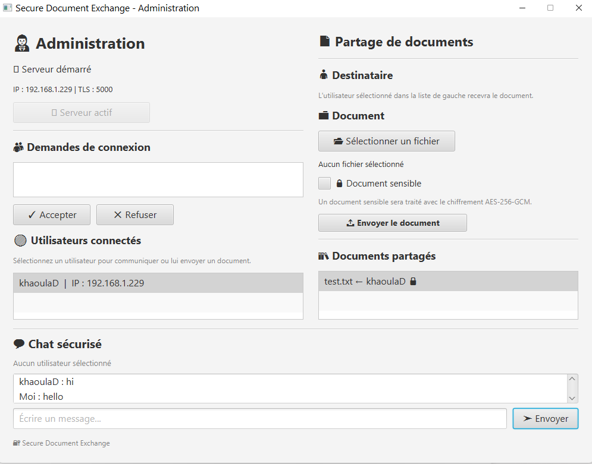
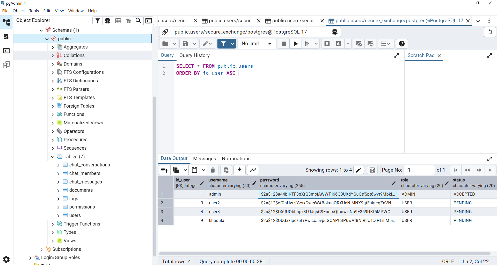

# SecureDocumentExchange

**SecureDocumentExchange** est une application Java / JavaFX de bureau client-serveur hautement sécurisée, conçue pour permettre l'authentification des utilisateurs, la communication en temps réel par chat chiffré, et le transfert sécurisé de documents (avec option de chiffrement AES-256-GCM)[cite: 1, 6, 7].

## 🚀 Fonctionnalités Principales

- **Authentification & Rôles :** Inscription et connexion sécurisées avec gestion des rôles (Administrateur et Utilisateur).
- **Sécurité Réseau & Chiffrement :** Communications protégées par TLS/SSL et chiffrement des fichiers sensibles via AES-256-GCM.
- **Tableau de Bord Administrateur :** Gestion des connexions entrantes, suivi des utilisateurs connectés et partage de documents.
- **Espace Utilisateur :** Recherche de serveurs disponibles, demande de connexion, téléchargement/envoi de fichiers et chat en direct.
- **Journalisation (Logs) :** Traçabilité complète des actions enregistrées en base de données relationnelle (PostgreSQL).

---

## 🛠️ Technologies Utilisées

- **Langage :** Java / JavaFX (Interfaces FXML)
- **Build & Dépendances :** Maven
- **Réseau & Sécurité :** Sockets Java, TLS/SSL, AES-256-GCM, Hachage de mots de passe
- **Base de Données :** PostgreSQL / JDBC (Gestion via DAO)

---

## 📷 Captures d'écran de l'Application

### 1. Authentification et Inscription
L'accès à l'application nécessite de s'authentifier ou de créer un compte utilisateur.

|         Écran de Connexion          |               Écran d'Inscription       |
|:-----------------------------------:|:---------------------------------------:|
|  | |

---

### 2. Espace Utilisateur & Connexion au Serveur
L'utilisateur peut rechercher un serveur disponible, envoyer une demande de connexion et échanger des fichiers ou des messages.

|     Recherche et Connexion au Serveur      |             Réception d'un Document Chiffré   |
|:------------------------------------------:|:---------------------------------------------:|
| | |

---

### 3. Tableau de Bord Administrateur
L'administrateur supervise les connexions en temps réel, valide les accès et gère les transferts.

|          Vue d'ensemble du Serveur Actif           |      Utilisateur Connecté & Chat en Direct   |
|:--------------------------------------------------:|:--------------------------------------------:|
| [cite: 6] |  |

---

### 4. Base de Données (PostgreSQL)
Structure relationnelle gérant les utilisateurs, les rôles, les logs et les conversations.



---

## 🚀 Lancement du Projet

Vous pouvez exécuter l'application de deux manières différentes :

1. **Via l'interface Maven d'IntelliJ IDEA :**
    * Ouvrez le panneau latéral **Maven** sur la droite de votre IDE.
    * Développez **Plugins** > **javafx**.
    * Double-cliquez sur la tâche **`javafx:run`** pour lancer l'application.

2. **Via le terminal :**
   ```bash
   mvn javafx:run

## 📦 Installation et Lancement

1. **Cloner le dépôt :**
   ```bash
   git clone [https://github.com/khaouladimassi/SecureDocumentExchange.git]